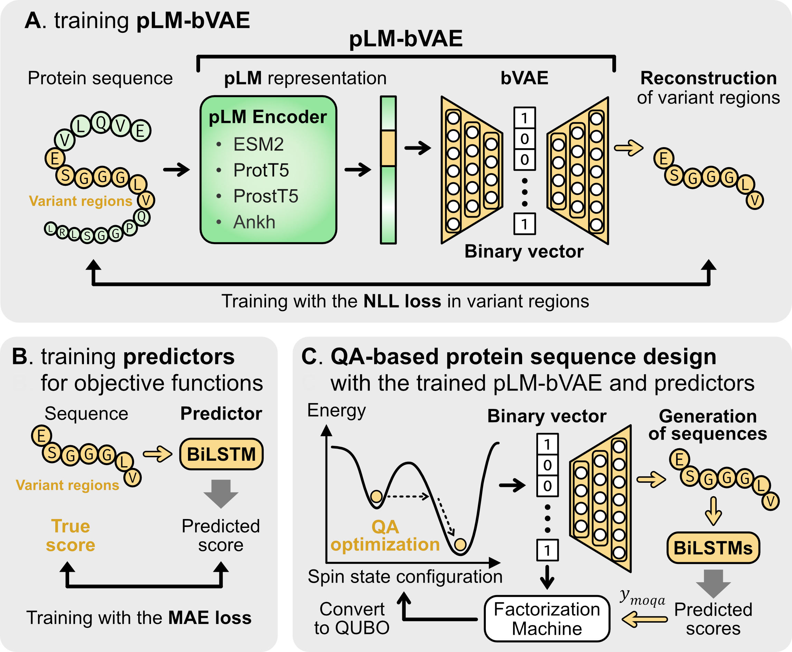

# pLM-bVAE

pLM-bVAE is a protein language model-enhanced binary representation method for quantum annealing (QA)-based protein sequence design. It combines a pretrained protein language model (pLM) encoder with a binary variational autoencoder (bVAE) to encode protein variant regions as binary vectors and reconstruct amino acid sequences from those vectors. This repository provides the code and data for the paper's experiments and a tutorial for the design workflow.

## Overview

- **A. Training pLM-bVAE:** A pLM encoder converts a full-length protein sequence into residue-level representations. Representations for the variant region are passed to the bVAE, which encodes them as a binary vector and reconstructs the variant sequence. The bVAE is trained with negative log-likelihood (NLL) loss, while the pLM encoder is frozen. The figure shows ESM2, ProtT5, ProstT5, and Ankh as pLM choices.
- **B. Training predictors:** Bidirectional long short-term memory (BiLSTM) predictors are trained on variant sequences and their measured scores using mean absolute error (MAE) loss. For each dataset, three predictors estimate the same property; their predictions are used separately in the multi-objective optimization.
- **C. QA-based protein sequence design:** The trained decoder generates sequences from binary vectors, and the predictors score those sequences. Multi-objective optimization by quantum annealing (MOQA) uses non-dominated sorting to assign a score to each sequence. A factorization machine is trained on the binary vectors and MOQA scores, then converted to a quadratic unconstrained binary optimization (QUBO) problem for QA. The sampled vectors are decoded and evaluated, and the resulting data are used to retrain the factorization machine in subsequent iterations.

## Repository contents

| Directory | Purpose |
| --- | --- |
| [`reproduction_paper/`](reproduction_paper/README.md) | Data, scripts, and analysis notebooks for reproducing the paper's experiments. It covers bVAE and pLM-bVAE training and evaluation, PARROT predictor training, MOQA-based design, and figure generation for MHC-I binding peptides, Trastuzumab-scFv CDRH3 variants, and AAV capsid surface region variants. Saved outputs can also be used for analysis. |
| [`tutorial_pLM-bVAE_QA_Protein_Design/`](tutorial_pLM-bVAE_QA_Protein_Design/README.md) | A step-by-step example using Trastuzumab-scFv CDRH3 variants. It covers data preparation, pLM-bVAE training, training three PARROT predictors, and running MOQA. |

Start with `reproduction_paper/` to reproduce or analyze the paper's experiments, or with `tutorial_pLM-bVAE_QA_Protein_Design/` to work through the design workflow. Follow the README in each directory for environment setup and path configuration. The provided MOQA sampler requires access to a compatible D-Wave solver.

## Citation and references

If you use this repository, please cite the software using the information in [CITATION.cff](CITATION.cff), together with the references relevant to your work:

- **Methods and predictors:** [bVAE](https://doi.org/10.1007/978-3-030-34518-1_10), [Optuna](https://doi.org/10.1145/3292500.3330701), [PARROT](https://doi.org/10.7554/eLife.70576), and [MOQA](https://doi.org/10.1038/s41598-023-51095-z).
- **Protein language models:** [ESM2](https://doi.org/10.1126/science.ade2574), [ProtT5 / ProtTrans](https://doi.org/10.1109/TPAMI.2021.3095381), [ProstT5](https://doi.org/10.1093/nargab/lqae150), and [Ankh](https://doi.org/10.48550/arXiv.2301.06568).
- **Datasets:** [IEDB for MHC-I binding peptides](https://doi.org/10.1093/nar/gky1006), [AlphaBind for Trastuzumab-scFv CDRH3 variants](https://doi.org/10.1080/19420862.2025.2534626), and [Bryant et al. for AAV capsid surface region variants](https://doi.org/10.1038/s41587-020-00793-4).
