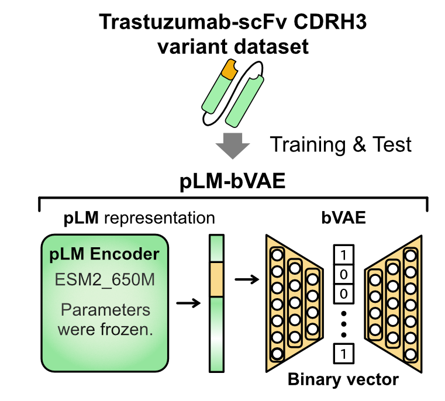
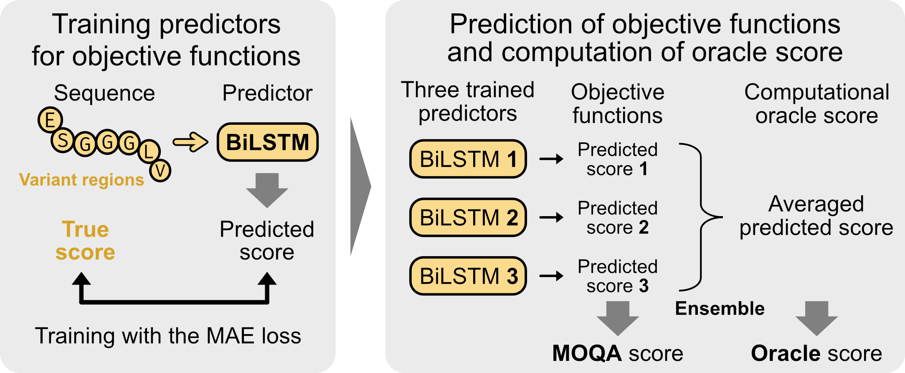
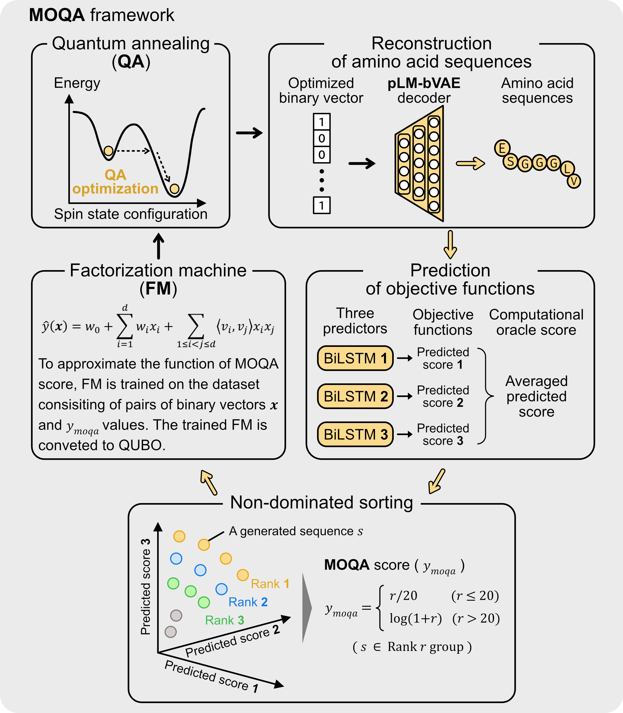

# Tutorial: pLM-bVAE and quantum annealing-based protein sequence design

This tutorial uses Trastuzumab-scFv CDRH3 variants to demonstrate a workflow for protein sequence design: prepare the data, train pLM-bVAE and three PARROT predictors, and run multi-objective optimization by quantum annealing (MOQA). pLM-bVAE maps amino acid sequences to binary vectors and reconstructs sequences from those vectors. MOQA uses the predictors to evaluate reconstructed sequences and guide the search in the binary latent space.

## Before starting

1. Set up the [pLM-bVAE and MOQA environment](environments/plm_bvae_moqa/README.md) and the separate [PARROT predictor training environment](environments/parrot/README.md). Apply the modified PARROT files as described in each environment's README.
2. Adapt paths in the notebooks, configuration files, and scripts to your machine. The scripts use Linux shell commands and some contain PBS or machine-specific settings. Update the conda initialization paths in `set_envs/`; in particular, `run_moqa.sh` currently refers to an older environment setup script and must be changed to use `setenv_plm-bvae-moqa-py310.sh`.
3. The preparation notebooks require Jupyter, pandas, NumPy, seaborn, and matplotlib; the download notebook also requires Hugging Face `datasets`. Install these in the notebook environment if needed. Model and dataset downloads require network access. GPU-enabled PyTorch is recommended for pLM embeddings and training; a D-Wave account and access to a compatible solver are required for the provided MOQA sampler.

## 0. Prepare the data

The example files under [`data/`](data/) can be used as a starting point. To regenerate them, update the `plm_data` paths and output directories in the notebooks under [`step0_data_preparation/`](step0_data_preparation/) and run them in this order:

1. [`cdrh3_data_huggingface.ipynb`](step0_data_preparation/plm_bvae/cdrh3_data_huggingface.ipynb) downloads and prepares the CDRH3 dataset.
2. [`cdrh3_data_random_split.ipynb`](step0_data_preparation/plm_bvae/cdrh3_data_random_split.ipynb) creates training, validation, and test files and the CDRH3 residue indices for pLM-bVAE.
3. [`cdrh3_parrot_dataset.ipynb`](step0_data_preparation/parrot/cdrh3_parrot_dataset.ipynb) prepares sequence-score pairs and split indices for PARROT.

The notebooks use the same random seed and a 0.8:0.1:0.1 split. Check that the resulting training, validation, and test sets match between pLM-bVAE and PARROT. The paths in the notebooks use Windows-style separators; adapt them if running on Linux.

## 1. Train pLM-bVAE



The frozen ESM-2 650M encoder produces residue-level representations of the Trastuzumab-scFv sequences. The representations of the CDRH3 variant region are provided to the bVAE, which learns to encode the sequences as binary vectors and reconstruct them. Hyperparameter optimization (HPO) can be used to select the pLM-bVAE training settings.

In [`step1_train_plm_bvae/esm_650m_opt/`](step1_train_plm_bvae/esm_650m_opt/), update the data, embeddings, model, and output paths in `experiment_configs/binary.yml`. After adapting the shell scripts and environment setup, generate ESM-2 embeddings for the training, validation, and test sets from this directory:

```bash
bash emb_esm2.sh
```

To perform HPO, configure and run `cre_opt_db.sh` followed by `opt_bvae.sh`, then select and apply the resulting hyperparameters. Train and evaluate pLM-bVAE with:

```bash
bash train_bvae.sh
bash eval_bvae.sh
bash encode_bvae.sh
```

These scripts train the model, evaluate it on the test set, and encode test sequences into binary vectors. Run `bash decode_bvae.sh` to reconstruct sequences from the vectors. Retain the trained `best/model.pt` checkpoint and its matching configuration for MOQA.

## 2. Train the PARROT predictors



Each PARROT predictor is a bidirectional long short-term memory (BiLSTM) model trained on variant-region sequences and their measured scores using mean absolute error (MAE) loss. The three predicted scores are used separately as objective function values in MOQA. Their average is used as a computational oracle score to evaluate optimization performance.

In [`step2_train_predictors_parrot/`](step2_train_predictors_parrot/), use the PARROT training environment. Update `model1/train.sh`, `model2/train.sh`, and `model3/train.sh` with the sequence-score file, split indices, and [`zscale3_encoding.txt`](zscale3_encoding.txt). The prepared split file is named `cdrh3_random_indices.txt`; update each script's `--split` path accordingly. For optional predictor HPO, adapt and run `model_optimize/opt_model.sh` using the training and validation data.

From `step2_train_predictors_parrot/`, run each training script in its model directory:

```bash
(cd model1 && bash train.sh)
(cd model2 && bash train.sh)
(cd model3 && bash train.sh)
```

The three trained `model/network.pt` files are inputs to MOQA.

## 3. Run MOQA



MOQA iteratively searches the binary latent space. The pLM-bVAE decoder reconstructs amino acid sequences from binary vectors, and the three predictors estimate their objective function values. Non-dominated sorting assigns a MOQA score to each sequence. A factorization machine (FM) is trained on the binary vectors and MOQA scores, then converted to a quadratic unconstrained binary optimization (QUBO) problem. Quantum annealing samples new binary vectors, and the cycle is repeated.

In [`step3_run_moqa/esm_650m_opt_moqa1/`](step3_run_moqa/esm_650m_opt_moqa1/), use the pLM-bVAE and MOQA environment and prepare the following inputs:

- Set `model_path` in `experiment_configs/binary.yml` to the trained pLM-bVAE model directory containing `best/model.pt`, and set `output_path` consistently with the sampler's `model_output/binary` paths.
- Place the three trained predictor weights at `parrot_models/model_network_1.pt`, `model_network_2.pt`, and `model_network_3.pt`, or update their paths in `sampler_moqa.py`. Confirm the Z-scale encoding path there as well.
- Place an initial set of 64-dimensional binary vectors in `model_output/binary/vectors.txt`. Example initial sets are in [`data/moqa_initial_data/`](data/moqa_initial_data/); choose one that matches the model's latent dimension.
- Configure the objective direction, hypervolume reference point, D-Wave endpoint, solver, and credentials in `sampler_moqa.py` for your experiment. Keep credentials out of files committed to a public repository.

After adapting `run_moqa.sh`, run `bash run_moqa.sh` from this directory. The sampler decodes the initial vectors, scores the sequences with the three predictors, and iteratively samples binary vectors using the quantum annealer. Generated vectors, reconstructed sequences, and optimization logs are written under `model_output/binary/`. Existing output files may be removed or overwritten, so preserve results before another run.

The environment definitions and workflow have not been validated end to end on every platform. Verify a small training and MOQA run on the target machine before a full experiment.
